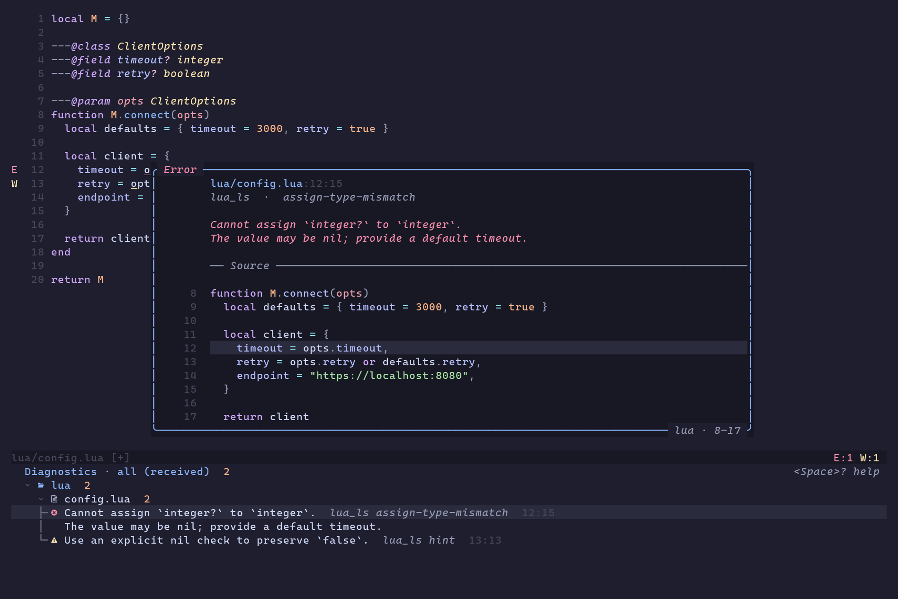
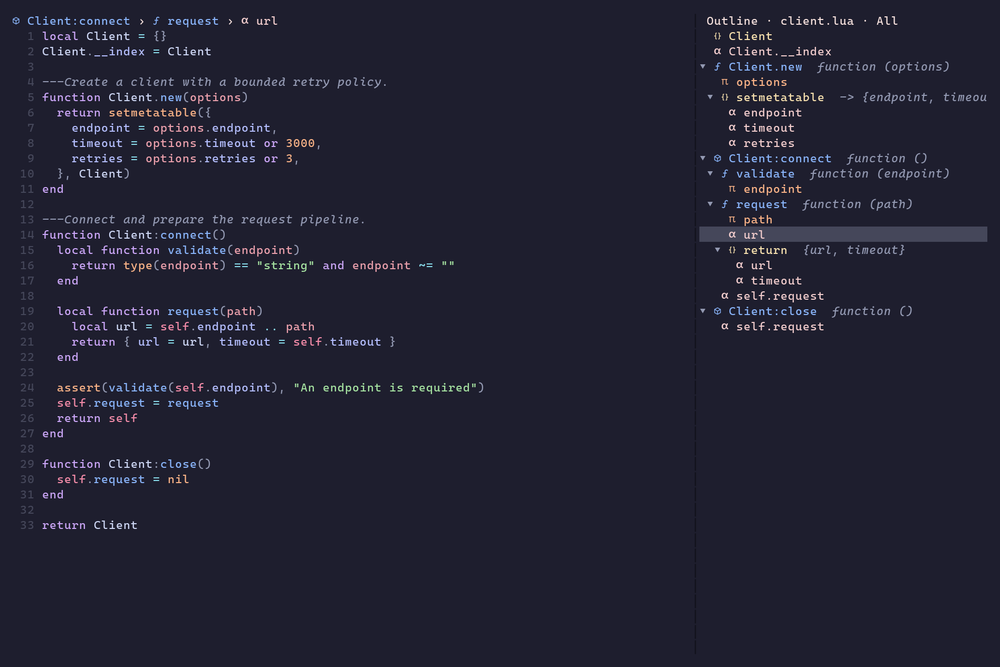
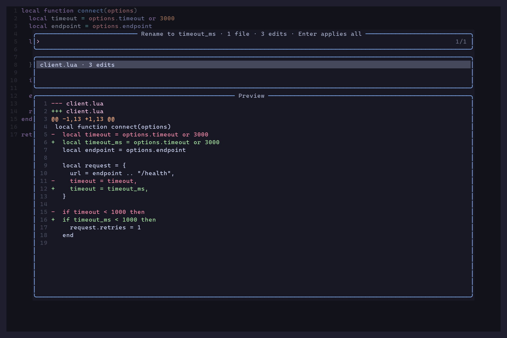

# lsp-tools.nvim

**See the context. Preview the change. Keep moving.**

Diagnostics with source previews, reviewable code actions and renames, and a
symbol outline that keeps your place in the file. Built around Neovim's LSP,
normal buffers, and the Vim motions you already use.

[Quick start](#quick-start) · [Everyday keys](#everyday-keys) ·
[More screenshots](#more-screenshots) · [Full guide](doc/guide.md)



*A diagnostic, its full message, and the surrounding code—together in one view.*

## What you get

- **Diagnostics with context.** Group by directory and file, filter by severity
  or producer, and preview the exact source range. Pin a snapshot or preview a
  fix and continue to the next confirmed diagnostic.
- **Searchable LSP navigation.** Find definitions, references, document/workspace
  symbols and diagnostics in selection-tools, with source previews and native jumps.
- **Changes you can review.** Inspect code-action diffs and all files affected by
  a rename before confirming. Previews include unsaved buffer contents; changes
  stay unsaved after applying.
- **A map of your code.** A colored symbol outline, current-scope breadcrumbs,
  and semantic reference navigation. TeX documents can show a focused structure
  of sections, frames, blocks, and lists.
- **Lists that stay useful.** Keep LSP locations, quickfix entries, location
  lists, and imported Snacks results in persistent panels with previews,
  history, filters, and native folds.
- **Vim throughout.** Search with `/`, move with `h/j/k/l`, select with `v`, and
  yank with `y`. Tool actions use a configurable prefix, leaving these motions
  available in result buffers.

## Quick start

Requires **Neovim 0.12** (tested with 0.12.6) and an LSP configured for your
language. Code actions, rename, outline, and other LSP features depend on the
methods your server supports. Diagnostic lists also include non-LSP producers.

Use [lazy.nvim](https://github.com/folke/lazy.nvim):

```lua
{
  "Jacky-Lzx/lsp-tools.nvim",
  dependencies = {
    "Jacky-Lzx/selection-tools.nvim",
    {
      dir = vim.fn.expand("~/Documents/Github/nvim_plugins/git-tools.nvim"),
      name = "git-tools.nvim", -- Point dir at your local git-tools checkout.
      main = "git_tools",
    },
  },
  event = "LspAttach",
  opts = {
    results = { auto_preview = true },
    diagnostics = true,
    pickers = true,
    breadcrumbs = { winbar = true },
  },
  config = function(_, opts)
    require("lsp-tools").setup(opts)
  end,
  keys = {
    {
      "<leader>gd",
      function() require("lsp-tools").diagnostics({ toggle = true }) end,
      desc = "Diagnostics with preview",
    },
    {
      "<leader>go",
      function() require("lsp-tools").toggle_outline() end,
      desc = "Symbol outline",
    },
    {
      "<leader>rn",
      function() require("lsp-tools").rename() end,
      desc = "Rename with preview",
    },
    {
      "<leader>a",
      function() require("lsp-tools").code_action() end,
      mode = { "n", "x" },
      desc = "Code action with preview",
    },
    {
      "]r",
      function() require("lsp-tools").jump_reference(vim.v.count1) end,
      desc = "Next semantic reference",
    },
    {
      "[r",
      function() require("lsp-tools").jump_reference(-vim.v.count1) end,
      desc = "Previous semantic reference",
    },
  },
}
```

Code-action and rename windows use selection-tools' public transaction APIs;
git-tools generates patches and renders native/delta previews. git-tools is a
new local plugin: clone or place its checkout at the `dir` above, or adjust that
path. It is not assumed to have a published remote release.
`:checkhealth lsp-tools` checks both dependencies without loading their UIs.

The keys above are suggestions; lsp-tools installs no global editor mappings.
The diagnostic overview opens with focus in your source window. Use `<C-w>j` to
enter a bottom results panel, or pass `focus = true` to `diagnostics()`.

If another plugin owns your source winbar, use `breadcrumbs = true` and integrate
[the breadcrumb component](doc/guide.md#current-location-breadcrumbs) with that
provider. Exclude `lsp-tools-results` from external winbar handling so result
panels retain their title and filters.

Already using code-actions.nvim? lsp-tools includes its implementation. Remove
the old plugin and move its options under `code_actions`;
[the migration guide](doc/guide.md#migrating-from-code-actionsnvim) has the details.

## Everyday keys

Inside a results panel:

| Key | Action |
| --- | --- |
| `<CR>` | Jump to a result, or fold a group |
| `]q` / `[q` | Next / previous result |
| `za` · `zM` · `zR` | Toggle a fold · close all · open all |
| `/` · `?` | Search forward / backward |
| `v`, then `y` | Select and copy text (`"+y` for the system clipboard) |
| `<LocalLeader>w` | Focus the source preview; Escape returns to the list |
| `<LocalLeader>/` | Open the filter menu |
| `<LocalLeader>F` | Pin / unpin the current results |
| `<LocalLeader>?` | Show the effective keys for this panel |
| `<Esc>` | Close the results panel |

`<LocalLeader>` follows `vim.g.maplocalleader`; Neovim's default is `\`.
Set it to Space **before opening a panel** if you prefer Space-prefixed actions:

```lua
vim.g.maplocalleader = " "
```

Code-action and rename pickers use **Enter to apply, Escape to cancel**. For a
rename, Enter applies the entire reviewed workspace edit, including every listed
file. Existing `vim.lsp.buf.code_action()` calls also use the preview picker.

## More screenshots

### Find your place in a large file

Breadcrumbs track the scope at the cursor. The outline shows the server's symbol
hierarchy, highlights the current symbol, and jumps back to its source location.



### Review a rename before applying it

See affected files, edit counts, and the actual diff. The example below renames a
local variable across three occurrences while keeping the table field unchanged.



These images show the plugin's actual Neovim UI grid, rendered to PNG with
**Catppuccin Mocha** and **Cascadia Mono NF**. Diagnostics use example messages;
the outline, breadcrumbs, and rename use a real **LuaLS** session. Layouts are
configured for the examples. Colors follow your theme.

## Make it yours

Use a compact side preview, change the action prefix, or choose an optional diff
renderer:

```lua
require("lsp-tools").setup({
  ui = { key_prefix = "<LocalLeader>" },
  results = {
    position = "bottom",
    auto_preview = true,
    preview = { layout = "right", before = 3, after = 6 },
  },
  outline = { width = 0.25, indent = 1 },
  -- Optional; native diff rendering works without delta.
  code_actions = { backend = "delta" },
})
```

Code actions, reference highlights/navigation, rename, outline, and breadcrumbs
are enabled by default. The quick-start configuration also enables result lists
and diagnostic details. Other tools are opt-in: pinned hover documentation,
call/type hierarchies, linked editing, semantic links, a code-action indicator,
and LSP inspection.

selection-tools is needed for search pickers, code actions and rename; git-tools
is needed for code-action and rename diff previews.
For the other tools, disable those integrations with
`code_actions = false, rename = false, pickers = false` and omit those dependencies. Snacks is optional, for importing existing picker
results. No plenary or external diff executable is required. Delta is
optional and falls back to native rendering if unavailable.

## Documentation

| Workflow | Guide |
| --- | --- |
| Setup, action prefixes, tool lifecycle | [Configuration](doc/guide.md#configuration) · [Panel mappings](doc/guide.md#panel-action-mappings) |
| Grouped diagnostics, filters, fixes | [Diagnostic overview](doc/guide.md#diagnostic-overview) · [Diagnostic details](doc/guide.md#optional-diagnostic-workflow) |
| Previews, folds, history, persistent lists | [Result lists](doc/guide.md#optional-persistent-result-lists) |
| Quickfix, location lists, LSP and Snacks results | [Quickfix / loclist](doc/guide.md#quickfix-and-location-list) · [LSP locations](doc/guide.md#persistent-lsp-locations) · [Picker import](doc/guide.md#import-picker-results) |
| Search definitions, references, symbols and diagnostics | [Search pickers](doc/guide.md#searchable-lsp-and-diagnostic-pickers) |
| Structure and semantic navigation | [Outline](doc/guide.md#symbol-outline) · [Breadcrumbs](doc/guide.md#current-location-breadcrumbs) · [References](doc/guide.md#reference-navigation) |
| Reviewable changes | [Rename](doc/guide.md#rename-preview) · [Code-action rendering](doc/guide.md#configuration) |
| More LSP tools | [Hover](doc/guide.md#optional-pinned-documentation) · [Hierarchies](doc/guide.md#optional-call-and-type-hierarchies) · [Inspection](doc/guide.md#optional-lsp-inspection) |

Run `:checkhealth lsp-tools` from a source buffer to check dependencies, preview
highlighting, attached providers, and winbar integration.
[Behavior and limits](doc/guide.md#behavior-and-limits) documents preview snapshots,
resource operations, and server-dependent behavior. The diagnostic overview shows
diagnostics Neovim has received; it does not scan unopened files itself.

For contributors: [test commands and coverage](doc/guide.md#tests) ·
[roadmap](TODO.md).
