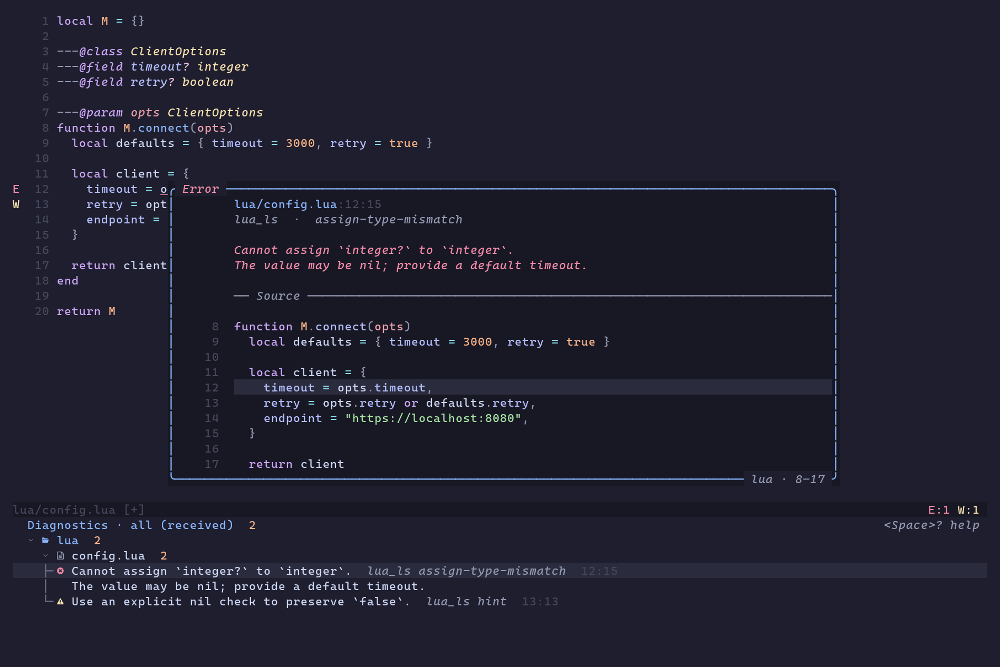
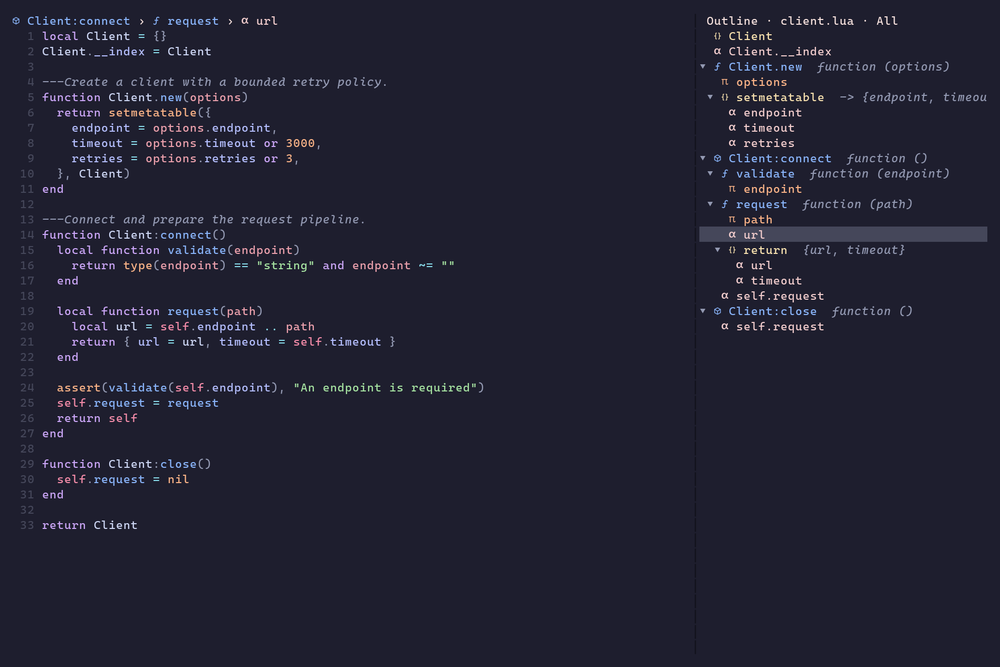
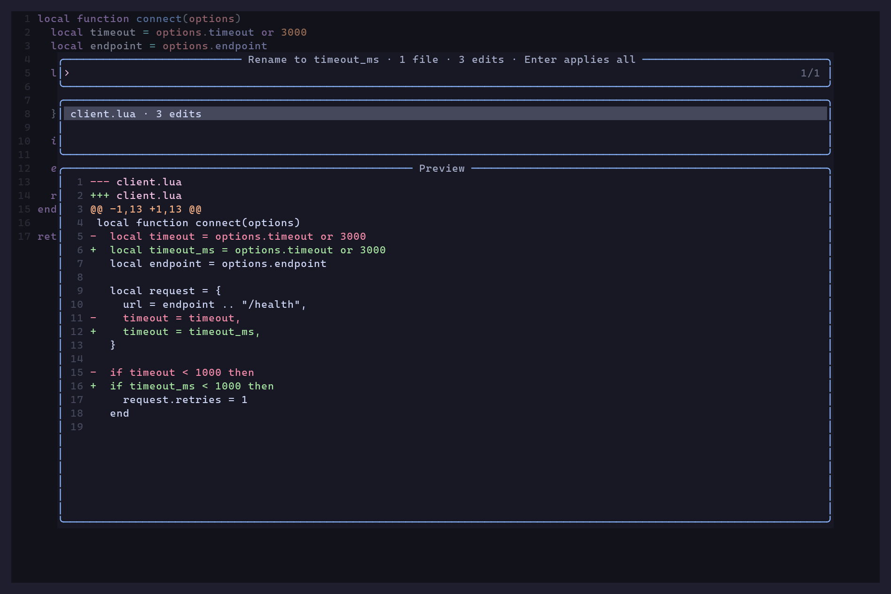

# Screenshots

[Quick start](../README.md)

Existing captures from real Neovim sessions. See the linked reproduction tools
where supplied by the original workflow documentation.

Grouped diagnostics with a syntax-highlighted source preview, severity title, and precise target range

Lua source with current-scope breadcrumbs and a colored, nested symbol outline

Rename preview showing three semantic edits from timeout to timeout_ms
