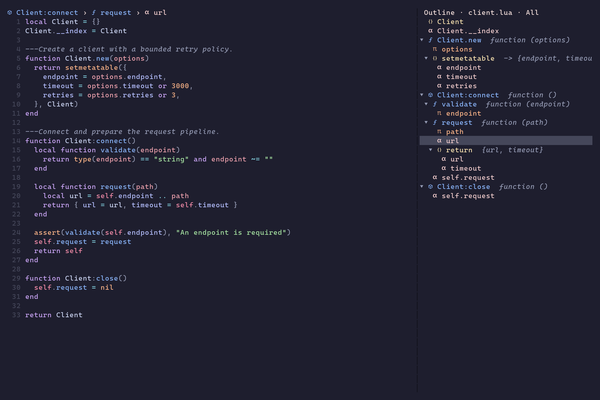
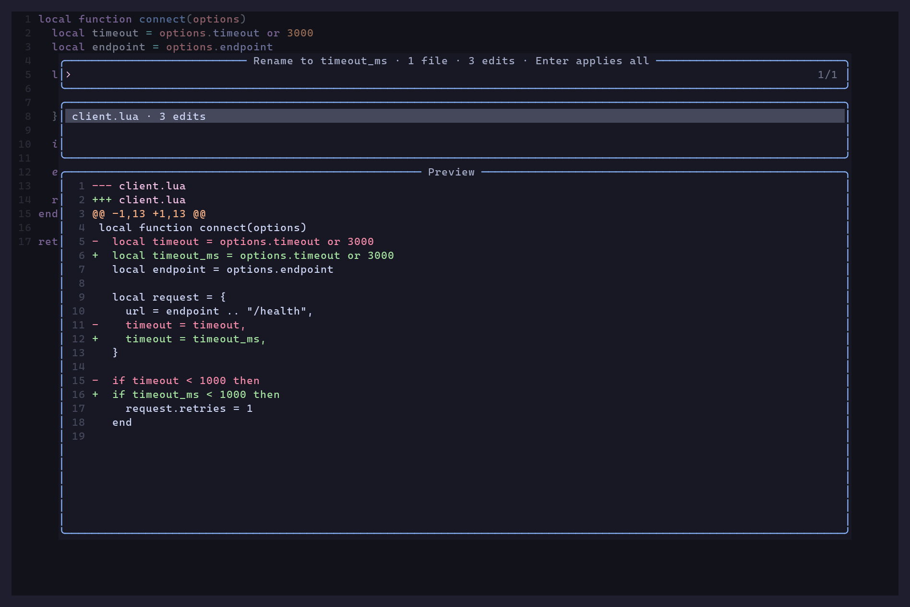

# Workflow and integration guide

[Quick start](../README.md) · [Complete reference](lsp-tools.txt)

Configuration defaults and API contracts are maintained in the help reference.
The examples here illustrate particular workflows.

## What you get

- **Diagnostics with context.** Group by directory and file, filter by severity
  or producer, and preview the exact source range. Pin a snapshot or preview a
  fix and continue to the next confirmed diagnostic.
- **Searchable LSP navigation.** Find definitions, references, document/workspace
  symbols and diagnostics in selection-tools, with source previews and native jumps.
- **Changes you can review.** Inspect code-action diffs and all files affected by
  a rename before confirming. Previews include unsaved buffer contents; changes
  stay unsaved after applying.
- **A map of your code.** A colored symbol outline, current-scope breadcrumbs,
  and semantic reference navigation. TeX documents can show a focused structure
  of sections, frames, blocks, and lists.
- **Lists that stay useful.** Keep LSP locations, quickfix entries, location
  lists, and imported Snacks results in persistent panels with previews,
  history, filters, and native folds.
- **Vim throughout.** Search with `/`, move with `h/j/k/l`, select with `v`, and
  yank with `y`. Tool actions use a configurable prefix, leaving these motions
  available in result buffers.

## Installation details

Requires **Neovim 0.12** (tested with 0.12.6) and an installed language server.
The configuration below uses nvim-lspconfig's maintained server configs;
lsp-tools applies your overrides and enables the selected servers through native
Neovim LSP. Code actions, rename, outline, and other LSP features depend on the
methods your server supports. Diagnostic lists also include non-LSP producers.

Use [lazy.nvim](https://github.com/folke/lazy.nvim):

```lua
{
  "Jacky-Lzx/lsp-tools.nvim",
  dependencies = {
    "neovim/nvim-lspconfig",
    "Jacky-Lzx/selection-tools.nvim",
    {
      "Jacky-Lzx/git-tools.nvim",
      name = "git-tools.nvim", -- Point dir at your local git-tools checkout.
      main = "git_tools",
    },
  },
  lazy = false, -- Configure servers before the first LspAttach.
  opts = {
    server_activation = "filetype", -- Enable configs when their filetypes are opened.
    server_filetypes = { lua_ls = { "lua" } }, -- Optional hints defer native config resolution.
    servers = {
      lua_ls = true, -- Install lua-language-server separately; choose your servers here.
      -- clangd = { cmd = { "clangd", "--background-index" } },
    },
    results = { auto_preview = true },
    diagnostics = true,
    pickers = true,
    breadcrumbs = { winbar = true },
  },
  config = function(_, opts)
    require("lsp-tools").setup(opts)
  end,
  keys = {
    {
      "<leader>gd",
      function() require("lsp-tools").diagnostics({ toggle = true }) end,
      desc = "Diagnostics with preview",
    },
    {
      "<leader>go",
      function() require("lsp-tools").toggle_outline() end,
      desc = "Symbol outline",
    },
    {
      "<leader>rn",
      function() require("lsp-tools").rename() end,
      desc = "Rename with preview",
    },
    {
      "<leader>a",
      function() require("lsp-tools").code_action() end,
      mode = { "n", "x" },
      desc = "Code action with preview",
    },
    {
      "]r",
      function() require("lsp-tools").jump_reference(vim.v.count1) end,
      desc = "Next semantic reference",
    },
    {
      "[r",
      function() require("lsp-tools").jump_reference(-vim.v.count1) end,
      desc = "Previous semantic reference",
    },
  },
}
```

Code-action and rename windows use selection-tools' public transaction APIs;
git-tools generates patches and renders native/delta previews. git-tools is a
new local plugin: clone or place its checkout at the `dir` above, or adjust that
path. It is not assumed to have a published remote release.
`:checkhealth lsp-tools` checks both dependencies without loading their UIs.

Server management is opt-in. If your configuration already enables LSP servers,
omit `servers` and the nvim-lspconfig dependency here; UI-only use can keep
`event = "LspAttach"` instead of `lazy = false`. When using `servers`, load
nvim-lspconfig before setup and remove duplicate startup from legacy
`require("lspconfig").SERVER.setup()` calls or Mason automatic enablement.
See [server configuration and lifecycle](lsp-tools.txt)
for custom configs, disabling, ownership and status inspection.

The keys above are suggestions; lsp-tools installs no global editor mappings.
The diagnostic overview opens with focus in your source window. Use `<C-w>j` to
enter a bottom results panel, or pass `focus = true` to `diagnostics()`.

If another plugin owns your source winbar, use `breadcrumbs = true` and integrate
[the breadcrumb component](lsp-tools.txt) with that
provider. Exclude `lsp-tools-results` from external winbar handling so result
panels retain their title and filters.

Already using code-actions.nvim? lsp-tools includes its implementation. Remove
the old plugin and move its options under `code_actions`;
[the migration guide](guide.md#migrating-from-code-actionsnvim) has the details.

## Neovim Lua development

LuaLS library discovery now belongs to lua-tools.nvim. Move the former `lua`
option table to that plugin's `opts`, or to `require("lua_tools").setup(opts)`.
Use `:LuaTools` / `:LuaTools refresh` for library inspection and rescanning.
The old enabled `lua` option reports a migration error before changing LSP state.
Server configuration remains in lsp-tools or Neovim's native LSP configuration.

## Everyday keys

Inside a results panel:

| Key | Action |
| --- | --- |
| `<CR>` | Jump to a result, or fold a group |
| `]q` / `[q` | Next / previous result |
| `za` · `zM` · `zR` | Toggle a fold · close all · open all |
| `/` · `?` | Search forward / backward |
| `v`, then `y` | Select and copy text (`"+y` for the system clipboard) |
| `<LocalLeader>w` | Focus the source preview; Escape returns to the list |
| `<LocalLeader>/` | Open the filter menu |
| `<LocalLeader>F` | Pin / unpin the current results |
| `<LocalLeader>?` | Show the effective keys for this panel |
| `<Esc>` | Close the results panel |

`<LocalLeader>` follows `vim.g.maplocalleader`; Neovim's default is `\`.
Set it to Space **before opening a panel** if you prefer Space-prefixed actions:

```lua
vim.g.maplocalleader = " "
```

Code-action and rename pickers use **Enter to apply, Escape to cancel**. For a
rename, Enter applies the entire reviewed workspace edit, including every listed
file. Existing `vim.lsp.buf.code_action()` calls also use the preview picker.

## More screenshots

### Find your place in a large file

Breadcrumbs track the scope at the cursor. The outline shows the server's symbol
hierarchy, highlights the current symbol, and jumps back to its source location.



### Review a rename before applying it

See affected files, edit counts, and the actual diff. The example below renames a
local variable across three occurrences while keeping the table field unchanged.



These images show the plugin's actual Neovim UI grid, rendered to PNG with
**Catppuccin Mocha** and **Cascadia Mono NF**. Diagnostics use example messages;
the outline, breadcrumbs, and rename use a real **LuaLS** session. Layouts are
configured for the examples. Colors follow your theme.

## Make it yours

Use a compact side preview, change the action prefix, or choose an optional diff
renderer:

```lua
require("lsp-tools").setup({
  ui = { key_prefix = "<LocalLeader>" },
  results = {
    position = "bottom",
    auto_preview = true,
    preview = { layout = "right", before = 3, after = 6 },
  },
  outline = { width = 0.25, indent = 1 },
  -- Theme-aware native previews; "delta" and raw "vim" remain available.
  code_actions = { backend = "native", native = { file_header = false } },
  rename = { backend = "native", native = { file_header = false } },
})
```

Code actions, reference highlights/navigation, rename, outline, and breadcrumbs
are enabled by default. The quick-start configuration also enables result lists
and diagnostic details. Other tools are opt-in: styled native `K` and pinned hover documentation,
call/type hierarchies, linked editing, semantic links, a code-action indicator,
and LSP inspection.

selection-tools is needed for search pickers, code actions and rename; git-tools
is needed for code-action and rename diff previews.
For the other tools, disable those integrations with
`code_actions = false, rename = false, pickers = false` and omit those dependencies. Snacks is optional, for importing existing picker
results. No plenary or external diff executable is required. Delta is
optional and falls back to native rendering if unavailable. Native code action
and rename previews pass complete before/after documents to git-tools, preserving
Tree-sitter context across hunks and optional colors from an already-loaded pairs.nvim.

## Shared icon display

When theme-tools.nvim is configured, icons follow its shared icon API and
`:ThemeToolsIcons` selection (mini.icons, nvim-web-devicons, ASCII, or hidden).
Open views refresh when the display changes. Provider installation and updates
belong to theme-tools; no extra icon dependency is needed for this integration.
Without theme-tools, existing standalone defaults remain available.
Local icon-disable options still apply. Configure shared overrides through
`require("theme_tools").setup({ icons = { overrides = { ... } } })`.

With `server_activation = "filetype"`, optional `server_filetypes` maps server names
to activation hints (`{ "lua" }`, `{}` for never, or `false` for any nonempty filetype).
Hinted servers do not resolve or execute their native `lsp/*.lua` files at setup;
resolution and full validation happen synchronously before the first activation.
Unhinted servers retain immediate native resolution to discover their filetypes.
Hints are copied and merged across setup calls, and never replace native filetypes,
commands, root policies or hooks. Keep hints aligned with your native configs,
including `after/lsp/` overrides. Missing or invalid hinted definitions report errors
at first use; explicit status/health inspection also resolves them. Eager activation
continues to resolve and validate configurations during setup.

### Deferred server config providers

`server_provider = function() ... end` makes native config definitions available
just before resolution, for example by mounting nvim-lspconfig through the host's
plugin manager. With filetype activation and hints, registration does not call
the provider. The same function is called once after successful completion; a
failed callback remains retryable. Eager resolution and explicit server inspection
also prepare the provider. The callback owns availability only; lsp-tools still
validates, enables and manages servers through Neovim's native APIs.

`:LspToolsInfo` inspects clients, roots, providers and requests.

## Migrating from code-actions.nvim

Remove the old code-actions.nvim specification, replace `require("code_actions")`
with `require("lsp-tools")`, and move its setup options under `code_actions`.
lsp-tools includes that implementation; it does not load or depend on the old
plugin. Install selection-tools.nvim and the local git-tools.nvim checkout for code-action
and rename previews.

After setup, native `vim.lsp.buf.code_action()` and the default `gra` mapping use
the preview picker. Confirm with Enter, cancel with Escape. These bindings apply
to the picker input and list; lsp-tools installs no global editor mappings.
Ordinary `vim.ui.select` requests keep using your existing provider.
